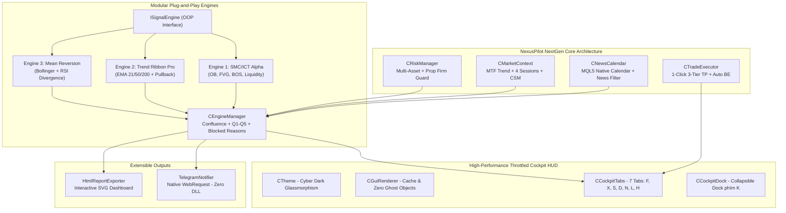

# 📋 BÁO CÁO AUDIT & KIẾN TRÚC KAIZEN DỰ ÁN NEXUSPILOT NEXTGEN

---

## PHẦN 1: BÁO CÁO AUDIT HIỆN TRẠNG (EAFREE PILOT v2.30)

### 1. Phân tích tài nguyên hiện có trong thư mục:
Qua rà soát và giải mã toàn bộ thư mục gốc `EafreePilot/`:
1. **`EAFreePilot_v2.30.ex5`** (Dung lượng 948 KB):
   - Đây là file nhị phân đã biên dịch của MetaTrader 5 (MQL5 Bytecode).
   - Được biên dịch trên MetaQuotes Compiler phiên bản mới (sử dụng VM ảo hóa, mã hóa AES chuỗi ký tự và tài nguyên).
   - Không cung cấp mã nguồn mở (.mq5/.mqh), khiến người dùng phụ thuộc 100% vào nhà phát triển bên thứ ba.
2. **`EAFreePilot_Huong_Dan_v4.0.pdf` & `EAFreePilot_User_Guide_v4.0_EN.pdf`**:
   - Bộ tài liệu đặc tả chức năng phiên bản 4.0 (cho bản binary 2.30).
   - Cung cấp toàn bộ mô hình nghiệp vụ, thông số đầu vào (Inputs), cấu trúc Cockpit UI (FLIGHT, CTX, SIG, RADAR, NEWS, LOG, HELP, Dock bên trái phím K) và cơ chế tính toán tín hiệu.

---

### 2. Bảng đối chiếu hạn chế & Điểm nghẽn (Audit Findings):

| Thành phần | Thực trạng EAFree Pilot v2.30 | Hạn chế / Nguy cơ (Bottlenecks) |
| :--- | :--- | :--- |
| **Bản quyền & Khóa nhà cung cấp** | Ép buộc tài khoản Real phải mở dưới IB Exness hoặc Vantage. Hiện bảng pop-up chặn toàn bộ biểu đồ nếu không đạt điều kiện. | **Vendor Lock-in nghiêm trọng**: Trader chuyên nghiệp, người dùng tài khoản Prop Firm (FTMO, FundedNext, MFF), hoặc các Broker khác không thể sử dụng. |
| **Quyền thực thi lệnh** | Chỉ là **Indicator thuần túy**. Chỉ hiển thị gợi ý kế hoạch (Entry, SL, TP1/2/3). Trader phải tự mở cửa sổ Order của MT5 gõ lệnh thủ công. | **Mất cơ hội vào lệnh (Latency & Slippage)**: Tín hiệu M15/M5 đòi hỏi phản xạ nhanh. Việc nhập tay 3 lệnh TP1, TP2, TP3 rất dễ sai sót khối lượng và chậm trễ giá. |
| **An toàn hệ thống (Security)** | Bắt buộc bật **`Allow DLL imports`** trong MT5. | **Rủi ro bảo mật & Bị chặn**: Rất nhiều công ty quản lý quỹ (Prop Firms) và VPS cấm tuyệt đối file EA/Indicator chạy DLL ngoài vì nguy cơ rò rỉ mã độc và vi phạm sandbox. |
| **Mô hình kiến trúc** | Black-box đóng kín, không có cơ chế mở rộng Plugin / Strategy Engine. | Không thể kết hợp các chiến lược hiện đại (SMC, Order Block, Liquidity Sweep, Trend Ribbon) hay tùy chỉnh tham số theo sở thích. |
| **Hiệu năng đồ họa (GUI Rendering)** | Vẽ hàng trăm Graphic Objects (`OBJ_LABEL`, `OBJ_RECTANGLE_LABEL`) trực tiếp trong luồng sự kiện mỗi tick. | **Gây tụt FPS và lag MT5** khi thị trường có biến động mạnh (tin tức ra, hàng chục tick/giây). |
| **Bảo vệ tài khoản (Risk Guard)** | Chỉ gợi ý % Lot tính toán tĩnh. Không có cơ chế khóa Drawdown trong ngày. | Dễ dẫn đến trường hợp trader vi phạm quy tắc Maximum Daily Drawdown của các quỹ cấp vốn. |

---

## PHẦN 2: CHIẾN LƯỢC KAIZEN - XÂY DỰNG NEXUSPILOT NEXTGEN

Dự án **NexusPilot** được xây dựng lại từ nền tảng gốc theo triết lý **Kaizen (Cải tiến liên tục)**: Giữ trọn vẹn mô típ "Cockpit HUD trực quan", nhưng **tối ưu hóa toàn diện** về kiến trúc phần mềm, bảo mật, hiệu năng và tính năng thực chiến.

---

## PHẦN 3: BẢNG SO SÁNH ĐỐI ĐẦU (EAFREE PILOT vs NEXUSPILOT)

| Tiêu chí | EAFree Pilot v2.30 (Cũ) | NexusPilot NextGen (Mới - Kaizen) | Lợi ích thực chiến |
| :--- | :--- | :--- | :--- |
| **Mã nguồn (Source Code)** | File `.ex5` đóng kín, mã hóa. | **100% MQL5 Mã nguồn mở**, module hóa Clean OOP. | Tự chủ hoàn toàn, kiểm toán được mã nguồn, dễ dàng mở rộng. |
| **Bản quyền & IB** | Khóa IB cứng (Exness/Vantage). | **Tự do 100%**: Hoạt động trên mọi Broker, Demo, Real, và quỹ Prop Firm. | Không bị phụ thuộc vào môi giới, bảo vệ tối đa lợi ích cá nhân. |
| **Thực thi lệnh** | Chỉ xem gợi ý (Manual only). | **1-Click Execution tích hợp**: Bấm BUY/SELL trực tiếp trên FLIGHT card. Tự động chia 3 lệnh TP1, TP2, TP3. | Khớp lệnh siêu tốc, chuẩn xác giá, không sợ trễ sóng. |
| **Quản lý vị thế động** | Không có. | **Auto Break-Even**: Khi chạm TP1, tự động dời SL của 2 lệnh còn lại về điểm hòa vốn + buffer. | Bảo toàn vốn tức thì (Risk-Free Trade), an tâm gồng lời. |
| **Bảo vệ tài khoản Quỹ** | Không có. | **Prop Firm Drawdown Guard**: Tự động giám sát mức sụt giảm vốn trong ngày; khóa vào lệnh nếu chạm 4% DD. | Giúp trader không bao giờ bị trượt luật thi quỹ (FTMO, MFF...). |
| **Phụ thuộc DLL** | Bắt buộc `Allow DLL imports`. | **Zero DLL**: Sử dụng MQL5 native `WebRequest()` gửi Telegram. | An toàn tuyệt đối, tương thích 100% mọi VPS và quy định khắt khe của sàn. |
| **Kiến trúc Engine** | Cố định, không rõ giải thuật bên trong. | **3 Engines chuẩn mực**: SMC (FVG/OB), Trend Ribbon (EMA), Mean Reversion. Bật tắt từng Engine độc lập. | Minh bạch tín hiệu, đa dạng hóa chiến lược theo chu kỳ thị trường. |
| **Minh bạch khi không có lệnh** | Dòng "Bị chặn" chung chung. | **Blocked Reason Engine chi tiết**: Phân tích rõ do Sideway, do cấn tin tức đỏ, do Spread giãn, hay do chạm Max DD. | Triệt tiêu hoàn toàn tâm lý nôn nóng FOMO. |
| **Hiệu năng biểu đồ** | Vẽ trực tiếp trên tick. | **Throttled Rendering (300ms)** tách biệt luồng OnTick. | MT5 chạy mượt mà 60 FPS, không drop khung hình. |
| **Báo cáo hiệu suất** | Xuất báo cáo cơ bản. | **Standalone HTML Dashboard**: Biểu đồ SVG đường cong lợi nhuận, phân tích R:R, Win Rate, Heatmap. | Xem báo cáo trực quan trên trình duyệt mọi lúc. |
